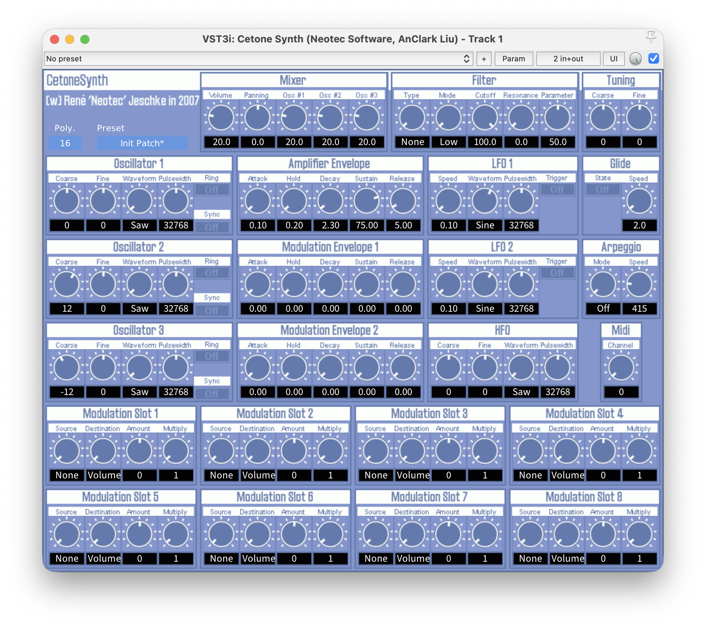

# CetoneSynth

CetoneSynth is a deluxe analogue-style synthesizer by Neotec Software. It is the full-featured member of the Cetone Synth series, and the companion of [CetoneSynthLight](https://github.com/AnClark/CetoneSynthLight). **Originally written by [René Jeschke](https://github.com/rjeschke).**

Sadly, Cetone Synth series had been discontinued for more than 12 years (since 2012), and it only supported VST 2.4. Original project is [here](https://github.com/rjeschke/cetonesynths).

**But now, I (AnClark) brings it to life again, by re-implementing those plugins to [DISTRHO Plugin Framework](https://distrho.github.io/DPF/).** It now runs well on most modern platforms.

CetoneSynth was originally a monophonic synth, but I have added polyphony support to it. So now it is a 16-voice polyphonic synthesizer. The original monophonic behavior is still available as a build option (see [Build options](#2-build)).



## Features

- **3 oscillators with 5 waveforms**
  - Basic waveforms: Sine, Saw, Triangle, Square (pulse)
  - **Commodore 64 (C64) flavored noise generator** (switch waveform to "Noise")
  - Per-oscillator **ring modulation** and **hard sync**
- **Analog-modelled filter**
  - **Support 7 classic filter models**: Dirty, Moog, Moog2, Ch12db, x0x, 8580, Bw24db
  - Switchable filter mode: Low, Band, High, Notch
  - Resonance support
- **8 modulation slots** (twice as many as CetoneSynthLight)
  - Sources: Velocity, Ctrl 1, Mod Env 1/2, LFO 1/2, HFO, plus matrix sources MEnv1×LFO1 and LFO1×LFO2
  - Destinations: volume, panning, pitch, cutoff, resonance, per-oscillator volume / pitch / pulse width, LFO speeds, and filter parameter
  - Tunable modulation amount and multiply factor
- **Full polyphony support**
  - Up to 16 voices
  - Tunable polyphony voice count
  - Polyphony can be set to 1 for monophonic mode
- **2 LFOs, plus HFO**
  - The 4th oscillator works as a High Frequency Oscillator (HFO), usable as a modulation source
- **3 AHDSR envelopes**
  - Amplifier AHDSR
  - 2 × Modulation AHDSR
- Glide (portamento) support
- C64-style arpeggiator
  - Supports polyphonic arpeggiation (optional)
- **Cross-platform**
  - Supports: Windows, macOS, Linux
- **Multi-format**
  - Provides: VST 2.4, VST3, LV2, CLAP, Standalone ([JACK](https://jackaudio.org/) only)
- **Preset manager**
  - Save and load presets in JSON format (`.csynth`), banks stored as `.csynthbank`
  - Preset manager menu with bank and program support
  - Import / export via native file dialogs
  - Optional built-in factory presets (`CETONE_INCLUDE_FACTORY_PRESETS`)

## How To Build

### 0. Prerequisites

You need to install GCC, CMake, GNU Make and Ninja on your platform. Ninja is highly recommended for its high performance.

### On Linux

```bash
# Ubuntu
sudo apt update
sudo apt install gcc cmake make ninja

# Arch Linux
sudo pacman -Syu
sudo pacman -S gcc cmake make ninja
```

### On Windows

**You need to install Msys2 to build Cetone Synth series.** Download and install it from <https://msys2.org>.

After installation, run **MSYS2 UCRT64 Shell** from desktop (or Start Menu), then execute these commands:

```bash
pacman -Syu
pacman -S mingw-w64-ucrt-x86_64-gcc mingw-w64-ucrt-x86_64-cmake mingw-w64-ucrt-x86_64-ninja
pacman -S make
```

You can also install Git in Msys2, if you need:

```bash
pacman -S git
```

**Every command below should be executed in MSYS2 UCRT64 Shell.**

### 1. Clone source tree

```bash
# Source tree has 2 submodules: DPF and DPF-Widgets. So you need to add --recursive
git clone https://github.com/AnClark/CetoneSynth.git cetonesynth --recursive

# If you forget --recursive, run this
cd cetonesynth
git submodule update --init --recursive
```

### 2. Build

Cetone series now use CMake as build system. **All platforms share the same commands**.

You can explicitly specify built type here. For best performance, `Release` build is recommended. Optionally you can also set build type to `Debug`.

```bash
cd cetonesynth
cmake -S . -B build -DCMAKE_BUILD_TYPE=Release
cmake --build build
```

Built plug-ins reside in `build/bin`. Copy plugins to your DAW's search paths.

### Build options

| Option | Default | Description |
| --- | --- | --- |
| `CETONE_ENABLE_POLYPHONY` | `ON` | Set to `OFF` to build the original monophonic Cetone behavior. |
| `CONFIG_BUILD_LV2_ON_WINDOWS` | `OFF` | Set to `ON` to also build the LV2 format on Windows (including cross-compiling). LV2 is disabled on Windows by default, because the GitHub CI's Ubuntu runner cannot run `lv2-ttl-generator.exe` under Wine reliably. |

Example: build a monophonic CetoneSynth with LV2 on Windows:

```bash
cmake -S . -B build -DCMAKE_BUILD_TYPE=Release -DCETONE_ENABLE_POLYPHONY=OFF -DCONFIG_BUILD_LV2_ON_WINDOWS=ON
cmake --build build
```

### 3. Package (optional)

You can create distributable packages with CPack:

```bash
cd build
cpack
```

On macOS this generates a system installer (`.pkg`), on Windows and Linux a ZIP archive.

## License

- [René's original repo](https://github.com/rjeschke/cetonesynths) is provided 'as is' and license free for public use.
- This repository is licensed under GNU GPLv3.

## Credits

- [René Jeschke](https://github.com/rjeschke) - Original author
- [AnClark Liu](https://github.com/AnClark) - Maintainer of this repository. Re-implemented CetoneSynth to DPF.
